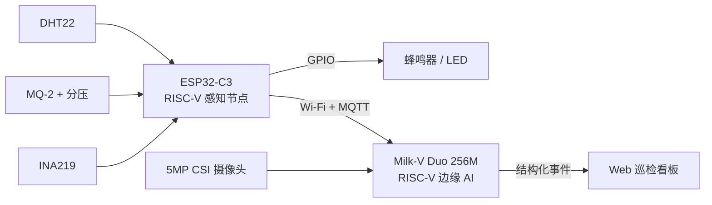

# RISC-V 硬件方案

智巡开源采用两个可独立工作的开放节点：

- **ESP32-C3 感知节点**：32 位单核 RISC-V MCU，负责温湿度、烟雾和功耗采集，通过 Wi-Fi/MQTT 上报；网络中断时仍能驱动蜂鸣器。
- **Milk-V Duo 256M 边缘 AI 节点**：SG2002 双 RISC-V C906 核心、256 MB 内存与 1 TOPS INT8 TPU，负责摄像头输入、视觉检测和多模态融合。

## 系统连接

## ESP32-C3 接线定义

| 模块 | 模块引脚 | ESP32-C3 引脚 | 说明 |
|---|---|---|---|
| DHT22 | DATA | GPIO4 | 3.3 V 供电，DATA 使用 10 kΩ 上拉 |
| MQ-2 | AO | GPIO0 / ADC1_CH0 | AO 必须经分压限制到 3.3 V 以下 |
| INA219 | SDA | GPIO8 | I2C 数据线 |
| INA219 | SCL | GPIO9 | I2C 时钟线 |
| 蜂鸣器 | SIG | GPIO10 | 大电流蜂鸣器需三极管驱动 |
| 状态 LED | SIG | GPIO5 | 串联 220 Ω 电阻 |

## 原型安全说明

- MQ-2 模块通常使用 5 V 加热，模拟输出不可直接超过 ESP32-C3 的 ADC 输入范围。
- 所有模块必须共地；切勿将市电直接接入 INA219 或开发板。
- 演示阶段建议使用低压直流负载验证功耗监测。

## 开源设计建议

下一版载板可在嘉立创 EDA 或 KiCad 中完成，保留 5 V 输入保护、3.3 V 稳压、MQ-2 分压、I2C 接口和声光告警驱动电路，并导出原理图 PDF、Gerber、BOM 与坐标文件共同发布。

## 官方资料

- [Espressif ESP32-C3 产品概览](https://docs.espressif.com/projects/esp-hardware-design-guidelines/en/latest/esp32c3/product-overview.html)
- [Milk-V Duo 系列规格与硬件资料](https://milkv.io/docs/duo/overview)
- [Milk-V Duo Buildroot SDK 说明](https://milkv.io/docs/duo/getting-started/buildroot-sdk)
